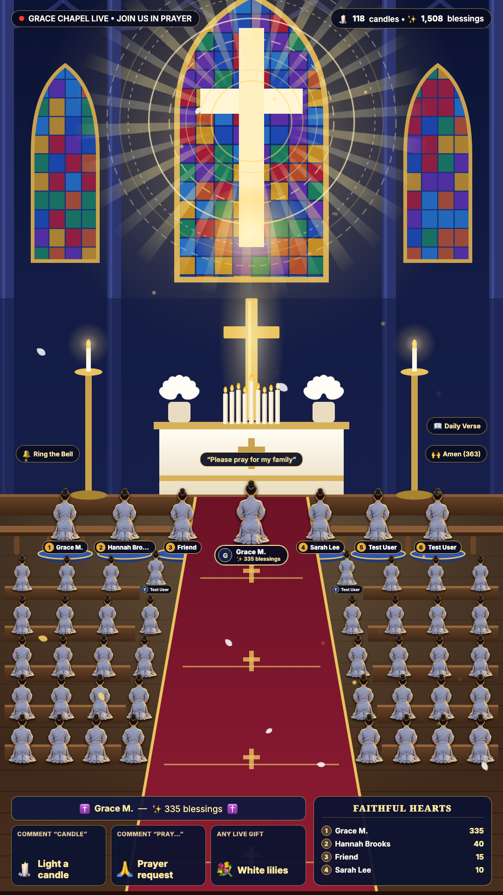
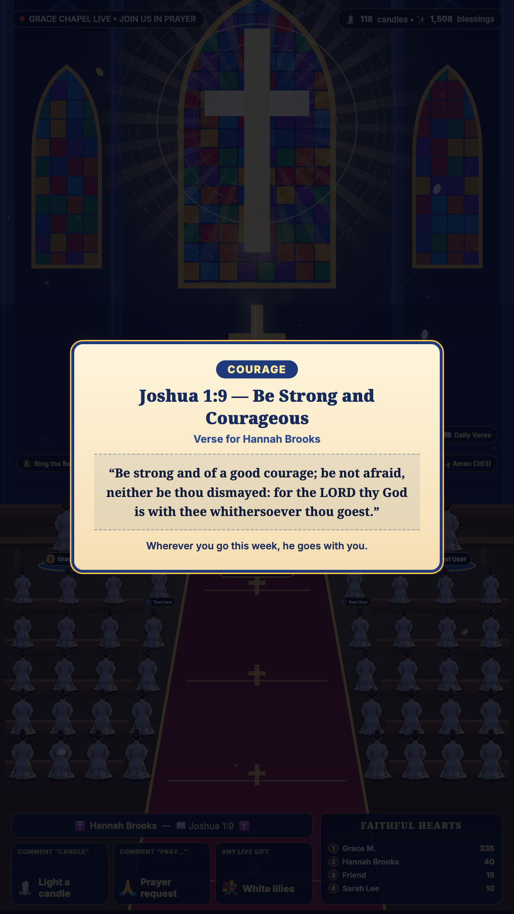

# ✝️ Grace Chapel Live — Interactive TikTok Live Sanctuary (9:16)

A 9:16 (`1080×1920`) interactive chapel scene for **OBS Studio / TikTok LIVE Studio**. Viewers take part through
**comments, likes, follows/shares and gifts**: they light candles, send prayer requests, ring the church bell,
say Amen and draw a Bible verse. Everything is also scriptable over **JSON-RPC 2.0**.

Reskinned from the original Buddhist-temple project (`zane-tv/tiktok-live-temple-rpc`). Game logic and the
TikTok integration are unchanged; only the theme layer is new. See [ASSETS.md](ASSETS.md) for placeholder art,
licenses and TikTok policy notes.




## Run it

```bash
npm install
npm start            # http://localhost:3000   (PORT=3111 npm start to change the port)
```

- Live screen + control dock: <http://localhost:3000>
- Clean OBS Browser Source (set size to `1080 × 1920`): <http://localhost:3000/?obs=1>
- Admin / RPC panel: <http://localhost:3000/admin>
- Click **Enable Sound & Voice** once (browsers block audio until a click).
- Connect to TikTok from the dock/admin, or start with `TIKTOK_USER=your_username npm start`.
  Nothing auto-connects unless you set `TIKTOK_USER`.
- Demo mode (fake viewers) in the dock is handy for testing.

Works on Node 18+ (tested on Node 24) and on Bun (`bun server.js`).

## Interaction map

| TikTok event | Trigger | On screen | Blessings |
| :-- | :-- | :-- | :-: |
| Like | each batch of likes | Soft "Amen" chime + part of the congregation bows their heads | `+1` / like |
| Follow / Share | follow or share | Church bell rings, sound rings spread | `+10` |
| Comment | `candle` | A viewer walks the aisle, kneels and lights candles, name is read aloud | `+15` |
| Comment | `pray`, `prayer`, `bless`, `peace`, `hope`, `faith`, `jesus`, `lord`, `god`… | Prayer request floats up, the viewer's words are read aloud | `+10` |
| Comment | `verse`, `bible`, `scripture` | A Bible verse card opens and is read aloud | `+10` |
| Comment | `bell`, `ring` | Church bell | `+10` |
| Comment | `amen`, `praise`, `hallelujah` | Amen chime + congregation bows | `+3` |
| Comment | anything else | One candle is lit (the comment is **not** read aloud) | `+5` |
| Small gift (1–4 coins) | any | White Lily Bouquet | `+20` / coin |
| Medium gift (5–99 coins) | any | Prayer Candle / Dove of Peace + bell | `+20–30` / coin |
| Big gift (≥ 100 coins) | any | **Hallelujah Celebration**: light rays, petals, bells | `+50` / coin |

"Blessings" are a fun score for the on-screen **Faithful Hearts** leaderboard. They carry no promise of any outcome.

## JSON-RPC 2.0 (`POST /rpc`, `ws://localhost:3000/ws`)

```bash
curl -X POST http://localhost:3000/rpc -H "Content-Type: application/json" -d '{
  "jsonrpc": "2.0", "id": 1, "method": "church.lightCandle",
  "params": { "user": "Grace M.", "count": 3, "wish": "Please bless my family with peace" }
}'
```

| Method | Params |
| :-- | :-- |
| `church.getState` | — |
| `church.lightCandle` | `user`, `avatar`, `count`, `wish` |
| `church.sendPrayer` | `user`, `avatar`, `wish` |
| `church.drawVerse` | `user`, `avatar`, `topic` |
| `church.sayAmen` | `user`, `count` |
| `church.ringBell` | `user`, `count`, `wish`, `readTts` |
| `church.offerGift` | `user`, `giftType` (`lily` \| `dove` \| `candle` \| `hallelujah`), `coins`, `giftName` |
| `church.grandCeremony` | `user`, `coins`, `giftName` |
| `church.comment` | `comment`, `user`, `uniqueId` — runs the real comment parser/moderation |
| `church.speak` | `text` — read aloud on the live screen |
| `church.updateSettings` | `musicVolume`, `ttsVolume`, … |
| `church.resetBlessings` | — |
| `live.connect` / `live.disconnect` | `username` |
| `live.setAutoSim` | `enabled` |

(Method names changed from `temple.*` to `church.*`; event names from `burnIncense` → `lightCandle`, `drawFortune` → `drawVerse`, etc.)

## Voice

Voice lines are read by the **browser's Web Speech API (en-US)** in the tab/OBS source that shows the live screen.
Free, no API key, no paid per-token service. Quality depends on the OS voices installed. The old Vietnamese-only
ZeroTTS worker was removed. If you want a nicer voice, plug in a local engine whose license allows commercial use.

## Moderation

Everything a viewer types can be read aloud on stream. `server.js` strips emoji/odd unicode, blocks profanity,
links/promo spam and mocking of faith, and rate-limits each viewer to one comment per 3.5 s. It is a first line only:
also turn on TikTok LIVE's own comment filters and keyword blocklist, and keep a moderator on duty.

## Files

```text
server.js              Express + WebSocket JSON-RPC server, TikTok connector, comment parser, verse deck
public/index.html      9:16 live screen + control dock
public/admin.html      RPC admin panel
public/css/live.css    styles (GPU-friendly, no filter:blur in loops)
public/js/live.js      scene logic, pose sequences, RPC client
public/js/audio.js     synthesized bell/chimes/ambient pad + Web Speech voice queue
public/js/particles.js 30 FPS canvas effects (candle glow, petals, bell rings)
public/assets/         placeholder SVG sanctuary + kneeling sprites (see ASSETS.md)
data/                  blessings-state.json (created at runtime, git-ignored)
```
